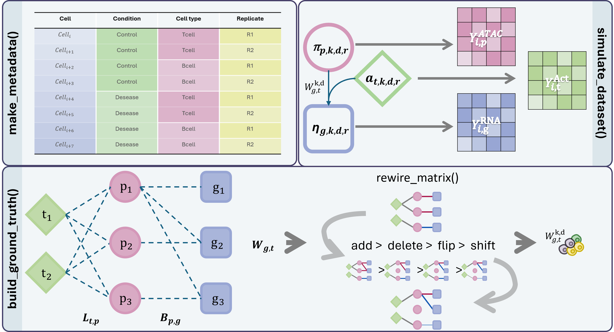

|  | <h1 style="margin: 0; font-size: 28px;">scNovoMOSim</h1><br>**Single cell de Novo simulator for paired scRNA-seq + scATAC-seq data with ground-truth gene regulatory networks** |
| :--- | :--- |

**Single cell de Novo simulator for paired scRNA-seq + scATAC-seq data with ground-truth gene regulatory networks**

`scNovoMOSim` is an R package for generating synthetic single-cell multiome datasets where the underlying regulatory architecture is fully known. It is primarily aimed at benchmarking GRN inference algorithms and differential network analysis tools.

<div align="center">
  
</div>

---

## Features

- Paired **scRNA-seq** (Negative Binomial) and **scATAC-seq** (Poisson, optionally binarised) count matrices
- Two regulatory layers: **TF → gene** (GRN) and **region ← TF** (chromatin accessibility)
- **Hierarchical network structure**: shared backbone → cell-type layers → condition-specific rewiring
- Controlled structural rewiring: **edge addition, deletion, sign-flip and weight drift**
- Full ground-truth edge lists and rewiring event tables for downstream benchmarking
- Realistic single-cell noise: correlated library sizes, logistic dropout, replicate batch effects
- Memory-efficient chunked cell generation

---

## Installation

Currently, the package can be installed directly from GitHub:  

```r
# Install from GitHub (requires devtools) 
devtools::install_github("BiostatOmics/MORE")
```

or 

```r
# Install from GitHub (requires remotes)
remotes::install_github("BiostatOmics/scNovoMOSim")
```

---

## Quick start

```r
library(scNovoMOSim)

# 1. Get default parameters and adjust as needed
cfg <- default_config()
cfg$n_genes          <- 500
cfg$n_tfs            <- 40
cfg$n_regions        <- 1000
cfg$n_cells_per_type <- c(TypeA = 300L, TypeB = 300L)
cfg$seed             <- 2024

# 2. Run simulation
sim <- simulate_dataset(cfg)

# 3. Quick sanity check
quick_qc(sim)

# 4. Export to disk
export_simulation(sim, outdir = "output/sim01", cfg = cfg)
```

---

## Output structure

`simulate_dataset()` returns a named list:

| Element | Type | Description |
|---|---|---|
| `RNA` | sparse Matrix (cells × genes) | Integer RNA counts |
| `ATAC` | sparse Matrix (cells × regions) | Integer or binary ATAC counts |
| `metadata` | data.frame | Cell-level annotations |
| `grn_edges` | data.frame | Ground-truth TF → gene edges |
| `region_tf_edges` | data.frame | Ground-truth region ← TF edges |
| `region_gene_links` | data.frame | Region → gene assignment |
| `rewiring_events` | data.frame | All structural network changes |
| `TFActivity` | matrix (cells × TFs) | Latent TF activity used during simulation |

---

## Simulation model

```
TF activity (A)
    │
    ├──[M: region-TF]──► logit(accessibility) ──► ATAC counts (Poisson)
    │                              │
    │                    chromatin drive (R2G)
    │                              │
    └──[W: TF-gene]────────────────►  log(RNA mean) ──► RNA counts (NB)
```

The GRN (`W`) and region-TF (`M`) matrices differ by cell type and condition. Condition-specific differences are introduced by `rewire_matrix()`, which records all structural changes in `rewiring_events`.

---

## Package structure

```
R/
├── config.R         # default_config()
├── metadata.R       # make_metadata()
├── rewiring.R       # rewire_matrix(), make_rewire_event()
├── ground_truth.R   # build_ground_truth(), matrix_to_*_edges()
├── simulate.R       # simulate_dataset()   ← main function
├── export.R         # export_simulation()
├── qc.R             # quick_qc()
└── utils.R          # sigmoid(), nb_counts()
```

---


